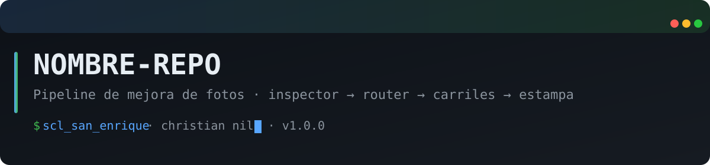

<p align="center">
  
</p>

<p align="center">
  
  
  
<a href="#"></a>
</p>

*Pipeline de mejora de fotos para un bot de impresión de Telegram — inspector multimodal → router por carriles → estampa de fecha analógica. En producción (F1 live) en scl-01.*
<!-- design: SCL_San_Enrique v1 — banner+badges -->
# print-bot-enhance

Pipeline de mejora de fotos para un bot de impresión de Telegram (Epson/Canon G3010/G3110). Lo usa mi print_bot en producción en scl-01.

```
Foto recibida
   → INSPECTOR (visión multimodal, JSON estricto)
   → ROUTER (reglas deterministas: flags → carriles)
   → CARRILES en serie: daño → rostros → color → upscale
   → ACABADO (estampa de fecha naranja retro DSEG14)
   → DATASET (entrenamiento futuro)
```

## Qué hace

- **Inspector**: clasifica la foto con JSON estructurado — `danos` (sin_danio/leve/severo), `rostros_degradados`, `color` (bn/deslavado/sano), `ruido`, `resolucion`. Acepta fotos que no hay que restaurar (evita sobre-procesar).
- **Router determinista**: el inspector NO decide, solo diagnostica. Las reglas de ruteo son puro código auditable.
- **Carriles activados solo si corresponden**. Orden fijo no negociable: daño→rostros→color→upscale (upescalar primero agudiza el daño; corregir después de escalar destruye detalle que no se recupera). La cara se restaura antes de colorizar (si no, la colorizzazione pone tez plana genérica).
- **Estampa de fecha**: formato clásico de cámara analógica — naranja #FF781E, DSEG14 (7 segmentos, look de calcúladora), esquina derecha-abajo, tamaño proporcional al ancho (~2.2%). Si la foto no trae EXIF, el **bot pregunta mientras sigue procesando en paralelo** (5 min máximo; si callan, sale sin fecha, sin drama).
- **Dataset**: guarda original + final + `sidecar.json` (diagnóstico, carriles, parámetros, latencia). Objetivo futuro: fine-tune con esos datos.

## Estado

- **F1 (live)**: inspector glm→kimi→qwen local + Real-ESRGAN x4 + estampa de fecha + dataset. Servicio `impression-bot` activo en scl-01.
- **F2 (planificado)**: carriles de daño (BOPBTL via ComfyUI), rostros (CodeFormer w≈0.7), color (DDColor).
- **F3 (planificado)**: clasificador local que reemplace al inspector de nube + preferencias por feedback 👍/👎.

## Setup

### 1. Dependencias de sistema

```bash
# Poppler (para leer EXIF)
apt install -y poppler-utils  # o tu gestor de paquetes

# Fuente DSEG14 (OFL, libre de redistribuir)
sudo mkdir -p /usr/share/fonts/truetype/dseg
sudo cp fonts/DSEG14Classic-BoldItalic.ttf /usr/share/fonts/truetype/dseg/
sudo fc-cache -fv
```

### 2. Python + torch CPU

**⚠️ Importante: usar Python 3.11** (basicsr 1.4.2 NO compila ni importa en Python 3.13+, y con torchvision nuevo se rompe `torchvision.transforms.functional_tensor`).

```bash
python3.11 -m venv /opt/print-enhance-venv
/opt/print-enhance-venv/bin/pip install --upgrade pip
/opt/print-enhance-venv/bin/pip install torch torchvision --index-url https://download.pytorch.org/whl/cpu
/opt/print-enhance-venv/bin/pip install -r requirements.txt --no-build-isolation

# Patch necesario (basicsr usa un módulo eliminado en torchvision nuevo):
sed -i 's/from torchvision.transforms.functional_tensor import rgb_to_grayscale/from torchvision.transforms.functional import rgb_to_grayscale/' \
  /opt/print-enhance-venv/lib/python3.11/site-packages/basicsr/data/degradations.py
```

### 3. Pesos del modelo (descarga separada)

```bash
# ⚠️ El release "v0.7.0" NO existe — usar v0.1.0
mkdir -p /opt/realesrgan-models/realesrgan-x4plus
curl -sL -o /opt/realesrgan-models/realesrgan-x4plus/RealESRGAN_x4plus.pth \
  "https://github.com/xinntao/Real-ESRGAN/releases/download/v0.1.0/RealESRGAN_x4plus.pth"
# Verificar: archivo debe pesar ~67 MB
```

### 4. Integrar a tu bot de Telegram

Ver `setup/impression_bot.py.example` para la plantilla (sin token, con placeholders). Modificar en tu `impression_bot.py`:

1. **Imports**: insertar sys.path al módulo `enhancement/` y `PENDING_DATE` dict
2. **Reemplazar el handler `print_photo`** con la versión de este repo (parches ya incluidos: init de `enhanced_info`, espera de fecha, fallback a original si el pipeline falla)
3. **Handler `/sinfecha`**: agregar el comando y su registro en `main()`
4. **Timeouts generosos en `Application.builder()`**: PTB default muere con `Timed out` en fotos grandes
5. **Variables de entorno** (recomendado): `PHOTOS_DATASET_DIR`, `REALESRGAN_MODEL`, `DSEG_FONT`, `PRINT_ENHANCE_PYTHON`

## Variables de entorno

| Var | Default | Descripción |
|---|---|---|
| `PHOTOS_DATASET_DIR` | `/root/photos_dataset` | Donde se archiva cada foto procesada |
| `PRINT_ENHANCE_PYTHON` | `/opt/print-enhance-venv/bin/python` | Python del venv (con torch) para ejecutar upscale |
| `REALESRGAN_MODEL` | `/opt/realesrgan-models/realesrgan-x4plus/RealESRGAN_x4plus.pth` | Pesos del modelo |
| `DSEG_FONT` | `/usr/share/fonts/truetype/dseg/DSEG14Classic-BoldItalic.ttf` | Fuente de la estampa |
| `FALLBACK_FONT` | `/usr/share/fonts/truetype/dejavu/DejaVuSansMono-Bold.ttf` | Fuente si no está DSEG |

## Inspector chain (no re-ordenar)

Verificado 04-nov-2026 con Ollama en producción:

1. `glm-5.3-flash:cloud` — cloud 1, legible, ~10s
2. `kimi-k2.6:cloud` — cloud 2, legible, ~20s
3. `qwen3.5:9b` — local CPU, batch (~2 min con `think:false`), fallback

**Nunca usar** llava/moondream como inspector: alucinan (`llava:7b` 1/5, `moondream` 0/5 sobre ground truth sintético; qwen3.5:9b 5/5).

⚠️ **Ollama structured outputs (`"format": ...schema`) SOLO FUNCIONA en modelos LOCALES** — los cloud responden prosa con JSON dentro. El parser (`photo_inspector.py`) lo maneja con `raw_decode` tolerante y 1 retry por modelo antes de saltar al siguiente.

## Test de rendimiento (verificado en Ryzen 2600 / 16GB CPU)

- upscale 700→1400px en **168s** (36 tiles, tile=128). Lotes OK, NO interactivo.
- inspector cloud glm-flash: **~10s**.
- inspector local qwen3.5:9b: **~2-3 min** (solo fallback/lotes).

## Pitfalls (leídos a fuego)

- **NUNCA escribir outputs del pipeline junto al input** si el input es un dataset/lote vivo (los outputs van a un workdir temporal). Esto corrompió un backup en vivo por accidente — lo captó el test end-to-end.
- Pesos de RealESRGAN: usar release **v0.1.0** (v0.7.0 del README oficial NO existe → 404)
- `basicsr` depende de un módulo eliminado de torchvision → sed arriba
- Ollama structured outputs NO funciona en cloud models
- Revisar `bin/python` symlink si se reusa un dir de venv con Python diferente
- Python 3.13+ NO sirve para basicsr 1.4.2

## Licencia

MIT — el módulo es software libre. La fuente DSEG14 es de su propio repo (keshikan/DSEG, Open Font License).

---

<p align="center">
  <i>Part of the <b>SCL_San_Enrique</b> server suite · Santiago, Chile 🇨🇱</i>
</p>
